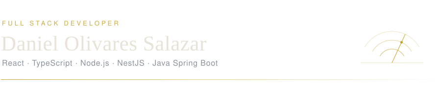
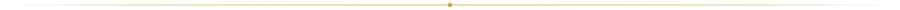

<picture>
  <source media="(prefers-color-scheme: dark)" srcset="assets/header-dark.svg">
  <source media="(prefers-color-scheme: light)" srcset="assets/header-light.svg">
  
</picture>

 

Ingeniero Civil en Computación por la Universidad Católica del Norte. Construyo
aplicaciones web de extremo a extremo: interfaces en React, Next.js y Angular
sobre APIs REST y GraphQL en NestJS y Java Spring Boot.

En **RedSalud** levanté ocho módulos de un CRM que hoy opera en nueve centros
médicos del país. Antes, en **Thoughtworks**, construí el frontend completo de un
producto interno en Angular 18. Ahora desarrollo herramientas propias de
automatización — abajo está lo que hay.

## Proyectos

### Job Radar

Los filtros de los portales de empleo mienten: marcan como remoto lo que es
híbrido y como junior lo que pide tres años. Job Radar lee la descripción
completa de cada aviso —no la metadata declarada— y lo clasifica como apto,
ambiguo o descartado según reglas explícitas. Notifica por Telegram y registra
todo lo analizado, incluido lo descartado y por qué, para poder auditar el
filtro.

Corre cada tres horas sobre GitHub Actions. Sin servidor: el propio repositorio
hace de base de datos.

&nbsp;&nbsp;→ [Repositorio](#)

 

### Gestión Médica

Sistema de gestión clínica construido en equipo durante la carrera. El backend
en NestJS expone una API GraphQL sobre PostgreSQL; el frontend web está en
Next.js y lo complementa una aplicación móvil. Es el proyecto donde más lejos
llevamos la separación entre capas: un esquema GraphQL como contrato único
consumido por dos clientes distintos.

Mi rol fue el desarrollo del frontend, junto a otra persona del equipo.

&nbsp;&nbsp;→ [Frontend](https://github.com/DanielOS1/cchad-frontend) &nbsp;·&nbsp; [Backend](https://github.com/DanielOS1/cchad-backend) &nbsp;·&nbsp; [Mobile](#)

 

### Plataforma de Ecommerce

Arquitectura de microservicios con seis servicios en NestJS que se comunican de
forma asíncrona vía RabbitMQ y se exponen con GraphQL. El frontend en React
consume esa API e integra Transbank, cubriendo el flujo de transacciones de
punta a punta.

 

### Gestión de Grupos

API REST propia en NestJS con modelo de datos en PostgreSQL y una aplicación
móvil en React Native con cinco módulos: autenticación, grupos, tareas, finanzas
y metas. Distribuida en Android.

&nbsp;&nbsp;→ [Backend](#) &nbsp;·&nbsp; [Mobile](#)

## Stack

## Contacto

Abierto a posiciones full stack, 100% remoto.

